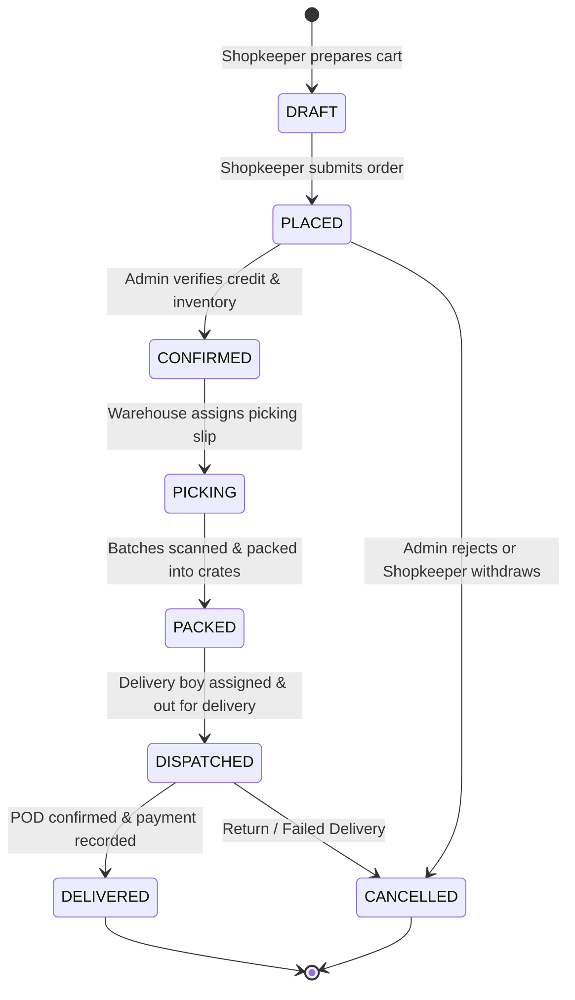

# 🏛️ Pharmacy Fantasy — System Design & Architecture Blueprint

> **Enterprise Architecture Document**  
> *Author:* Senior System Design & Architecture Consultant  
> *Domain:* B2B Pharmaceutical Wholesale & Supply Chain Distribution

---

## 1. Executive Architecture Summary

**Pharmacy Fantasy** is a full-stack, distributed B2B pharmaceutical wholesale management system designed to digitize and scale physical stock movements, order processing, delivery logistics, and GST-compliant invoicing.

```
┌────────────────────────────────────────────────────────────────────────┐
│                        CLIENT PRESENTATION TIER                        │
│                   Next.js 14+ (React 18/19, App Router)                │
│                                                                        │
│   ┌────────────────────┐ ┌────────────────────┐ ┌───────────────────┐  │
│   │ Wholesale Admin    │ │ Warehouse Staff    │ │ Shopkeeper Portal │  │
│   │ Operations Console │ │ Stock & Dispatch   │ │ Catalog & Orders  │  │
│   └────────────────────┘ └────────────────────┘ └───────────────────┘  │
└───────────────────────────────────┬────────────────────────────────────┘
                                    │ GraphQL (HTTP Queries/Mutations)
                                    │ GraphQL Subscriptions (WebSockets)
┌───────────────────────────────────▼────────────────────────────────────┐
│                         APPLICATION LOGIC TIER                         │
│                    FastAPI + Strawberry GraphQL (Python 3.11+)          │
│                                                                        │
│   ┌─────────────────┐  ┌─────────────────┐  ┌───────────────────────┐  │
│   │ Auth & RBAC     │  │ Product Catalog │  │ Order Orchestration   │  │
│   │ JWT Guard / OTP │  │ HSN & Pricing   │  │ State Machine Engine  │  │
│   └─────────────────┘  └─────────────────┘  └───────────────────────┘  │
│   ┌─────────────────┐  ┌─────────────────┐  ┌───────────────────────┐  │
│   │ Inventory/Batch │  │ GST Tax Engine  │  │ Delivery & Logistics  │  │
│   │ FEFO Allocation │  │ SGST + CGST Calc│  │ Real-time Assignment  │  │
│   └─────────────────┘  └─────────────────┘  └───────────────────────┘  │
└───────────────────────┬─────────────────────┬──────────────────────────┘
                        │                     │
┌───────────────────────▼──────┐       ┌──────▼──────────────────────────┐
│      PERSISTENCE TIER        │       │       CACHE & STORAGE TIER      │
│   PostgreSQL 15 (Relational) │       │   Redis 7 (Sessions & Cache)    │
│   - ACID Transaction Scope   │       │   MinIO / AWS S3 (PDF Invoices) │
│   - Strict Foreign Keys      │       │                                 │
└──────────────────────────────┘       └─────────────────────────────────┘
```

---

## 2. Domain Entities & Relational Topology

### Core Entity Relationships
1. **Users & Profiles**:
   - `User` ($1 \leftrightarrow 0..1$) `ShopkeeperProfile` (stores GSTIN, Drug License, Credit Limit, Balance)
   - `User` ($1 \leftrightarrow 0..1$) `DeliveryProfile` (stores Vehicle details, Assigned territory)
2. **Catalog & Inventory Batches**:
   - `Product` ($1 \leftrightarrow N$) `StockBatch`: Every medicine can have multiple active batches from manufacturers with independent batch numbers, expiry dates, purchase rates, and available quantities.
3. **Orders, Invoices & Dispatch**:
   - `Order` ($1 \leftrightarrow N$) `OrderItem`: Line items link to a specific `Product` and optionally reserved `StockBatch`.
   - `Order` ($1 \leftrightarrow 1$) `Invoice`: Legal GST tax invoice generated upon confirmation.
   - `Order` ($1 \leftrightarrow 1$) `DeliveryAssignment`: Field courier dispatch record.
4. **Purchase Ingestion**:
   - `PurchaseEntry` ($1 \leftrightarrow N$) `PurchaseItem`: Models inbound supplier purchase bills (e.g. from MAA Medical Agency to Warehouse).

---

## 3. Order State Machine & Lifecycle

The life of a wholesale pharmaceutical order transitions through strict operational gates:



### State Transition Safeguards:
- **Allocation Rule**: Inventory batches are reserved at `CONFIRMED` using **FEFO** (First-Expiry-First-Out) priority.
- **Stock Decrement**: `quantity_available` is formally decremented and `quantity_sold` is incremented upon transition to `PACKED`.
- **Cancellation Restitution**: If an order in `CONFIRMED`, `PICKING`, or `PACKED` is cancelled, allocated batch quantities are rolled back in a single atomic transaction.

---

## 4. Statutory GST & Pricing Engine

Pharmaceutical distribution in India is governed by the Central Goods and Services Tax (CGST) and State Goods and Services Tax (SGST) acts:

### Calculation Formula:
For each line item:
$$\text{Base Amount} = \text{Quantity} \times \text{Rate}$$
$$\text{Discount Amount} = \text{Base Amount} \times \left( \frac{\text{DIS1\%} + \text{DIS2\%}}{100} \right)$$
$$\text{Taxable Value} = \text{Base Amount} - \text{Discount Amount}$$
$$\text{SGST Amount} = \text{Taxable Value} \times \left( \frac{\text{SGST\%}}{100} \right)$$
$$\text{CGST Amount} = \text{Taxable Value} \times \left( \frac{\text{CGST\%}}{100} \right)$$
$$\text{Line Total} = \text{Taxable Value} + \text{SGST Amount} + \text{CGST Amount}$$

### Rounding & Compliance Standards:
- Standard intra-state GST split: $2.5\% \text{ SGST} + 2.5\% \text{ CGST} = 5.0\%$ total GST for most bulk medicines (HSN 3004).
- Free items (`free_quantity`) carry ₹0.00 rate and are exempt from taxable turnover while maintaining stock inventory audit records.
- Round-off rule: Final invoice values are rounded to the nearest integer ($\pm ₹0.50$).

---

## 5. Security & Multi-Role Access Control (RBAC)

| Role | Access Scope | Guard Mechanism |
| :--- | :--- | :--- |
| **SUPER_ADMIN** | Global system configuration, user creation, financial audits, analytics | `role == UserRole.SUPER_ADMIN` |
| **ADMIN** | Product catalog edits, order approvals, delivery assignment, reports | `role in [SUPER_ADMIN, ADMIN]` |
| **WAREHOUSE** | Stock batches, inbound purchase entries, picking & packing status | `role in [SUPER_ADMIN, ADMIN, WAREHOUSE]` |
| **DELIVERY** | Assigned delivery runs, status updates (`PICKED_UP`, `DELIVERED`), POD | `role == DELIVERY and assignment.delivery_boy_id == user.id` |
| **SHOPKEEPER** | Catalog viewing, placing orders, personal invoice & payment ledger | `role == SHOPKEEPER and order.shopkeeper_id == user.id` |

---

## 6. Scalability & Resilience Architecture

1. **Async I/O Core**: Backend built on ASGI (FastAPI) and async SQLAlchemy with connection pooling (`asyncpg`).
2. **Read-Heavy Catalog Caching**: Frequent queries (`products`, `active_batches`, `dashboard_stats`) are cached in Redis with a 60-second TTL and invalidation triggers on batch insertion.
3. **Offline Resilience**: Frontend implements an optimistic UI and fallback data layer enabling warehouse staff to continue draft actions even during brief network drops.
4. **Idempotency**: All payment and order placement mutations accept client-generated UUID keys to prevent duplicate billing during network timeouts.
