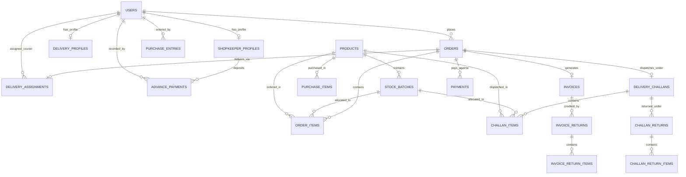

# 🗄️ Database Architecture & Relational Schema

> **Pharmacy Fantasy — Production PostgreSQL Relational Schema & Entity-Relationship Design**

---

## 1. Entity-Relationship Diagram (ERD)



---

## 2. Table Specifications & Column Definitions

### 2.1 Identity & User Access

#### `users`
Stores all system accounts across the 5 roles.
| Column | Type | Constraints | Description |
| :--- | :--- | :--- | :--- |
| `id` | `UUID` | `PK, DEFAULT gen_random_uuid()` | Primary unique identifier |
| `email` | `VARCHAR(255)` | `UNIQUE, NULLABLE` | Email for admin/staff login |
| `phone` | `VARCHAR(20)` | `UNIQUE, NULLABLE` | Phone for shopkeeper/courier login |
| `password_hash` | `VARCHAR(255)` | `NOT NULL` | Bcrypt password hash |
| `role` | `VARCHAR(20)` | `NOT NULL` | `SUPER_ADMIN`, `ADMIN`, `WAREHOUSE`, `DELIVERY`, `SHOPKEEPER` |
| `full_name` | `VARCHAR(255)` | `NOT NULL` | Display name of the user |
| `is_active` | `BOOLEAN` | `DEFAULT TRUE` | Soft-deactivation status |
| `created_at` | `TIMESTAMP` | `DEFAULT CURRENT_TIMESTAMP` | Account creation timestamp |
| `updated_at` | `TIMESTAMP` | `DEFAULT CURRENT_TIMESTAMP` | Last updated timestamp |

*Indexes*: `idx_users_role (role)`, `idx_users_phone (phone)`, `idx_users_email (email)`.

#### `shopkeeper_profiles`
Extended profile for Retail Shopkeepers.
| Column | Type | Constraints | Description |
| :--- | :--- | :--- | :--- |
| `id` | `UUID` | `PK, DEFAULT gen_random_uuid()` | Unique profile identifier |
| `user_id` | `UUID` | `FK(users.id), UNIQUE, NOT NULL` | Associated user account |
| `shop_name` | `VARCHAR(255)` | `NOT NULL` | Registered medical store name |
| `shop_address` | `TEXT` | `NOT NULL` | Counter address & locality |
| `gstin` | `VARCHAR(15)` | `NULLABLE` | 15-digit GSTIN (West Bengal prefix `19`) |
| `drug_license_no` | `VARCHAR(50)` | `NULLABLE` | State drug license number (Form 20B/21B) |
| `area` | `VARCHAR(100)` | `NULLABLE` | Delivery beat / commercial zone |
| `city` | `VARCHAR(100)` | `DEFAULT 'Durgapur'` | Municipality / City |
| `credit_limit` | `NUMERIC(12,2)`| `DEFAULT 0.00` | Approved wholesale credit ceiling in INR |
| `outstanding_balance`| `NUMERIC(12,2)`| `DEFAULT 0.00` | Current unpaid debt balance in INR |

*Indexes*: `idx_shopkeeper_area (area)`, `idx_shopkeeper_gstin (gstin)`.

#### `delivery_profiles`
Extended profile for Delivery Boys.
| Column | Type | Constraints | Description |
| :--- | :--- | :--- | :--- |
| `id` | `UUID` | `PK, DEFAULT gen_random_uuid()` | Unique profile identifier |
| `user_id` | `UUID` | `FK(users.id), UNIQUE, NOT NULL` | Associated courier account |
| `vehicle_type` | `VARCHAR(50)` | `DEFAULT 'Two-Wheeler'`| Motorcycle, Scooter, or Delivery Van |
| `vehicle_number` | `VARCHAR(20)` | `NULLABLE` | Vehicle registration plate (e.g., WB-40-AB-3421) |
| `assigned_area` | `VARCHAR(100)` | `NULLABLE` | Assigned delivery zone / beat |
| `is_available` | `BOOLEAN` | `DEFAULT TRUE` | Ready for new trip dispatch |

---

### 2.2 Product Catalog & Inventory

#### `products`
Master catalog of pharmaceutical SKUs.
| Column | Type | Constraints | Description |
| :--- | :--- | :--- | :--- |
| `id` | `UUID` | `PK, DEFAULT gen_random_uuid()` | Unique SKU identifier |
| `name` | `VARCHAR(255)` | `NOT NULL` | Brand name (e.g., AZITHRAL 500MG TAB) |
| `composition` | `TEXT` | `NULLABLE` | Active chemical ingredients (e.g., Azithromycin 500mg) |
| `manufacturer` | `VARCHAR(255)` | `NULLABLE` | Pharmaceutical manufacturer (e.g., Alembic) |
| `pack_size` | `VARCHAR(50)` | `NOT NULL` | Pack form: `10S`, `15S`, `60ML`, `30CAP` |
| `hsn_code` | `VARCHAR(20)` | `NULLABLE` | 8-digit GST HSN code (e.g., 30041090) |
| `category` | `VARCHAR(100)` | `NULLABLE` | Therapeutic class (Antibiotics, Analgesics) |
| `default_mrp` | `NUMERIC(10,2)`| `NULLABLE` | Benchmark MRP per pack |
| `default_sgst_rate`| `NUMERIC(5,2)` | `DEFAULT 2.50` | State GST rate percentage |
| `default_cgst_rate`| `NUMERIC(5,2)` | `DEFAULT 2.50` | Central GST rate percentage |
| `is_active` | `BOOLEAN` | `DEFAULT TRUE` | Master active status |
| `created_at` | `TIMESTAMP` | `DEFAULT CURRENT_TIMESTAMP` | Created at |

*Indexes*: `idx_products_name (name)`, `idx_products_hsn (hsn_code)`, `idx_products_category (category)`.

#### `stock_batches`
Physical inventory batches in warehouse racks.
| Column | Type | Constraints | Description |
| :--- | :--- | :--- | :--- |
| `id` | `UUID` | `PK, DEFAULT gen_random_uuid()` | Unique batch record ID |
| `product_id` | `UUID` | `FK(products.id), NOT NULL` | Associated pharmaceutical product |
| `batch_number` | `VARCHAR(50)` | `NOT NULL` | Manufacturer lot identifier |
| `expiry_date` | `DATE` | `NOT NULL` | Lot expiry date (FEFO sort key) |
| `purchase_rate`| `NUMERIC(10,2)`| `NOT NULL` | Cost rate per pack from distributor |
| `mrp` | `NUMERIC(10,2)`| `NOT NULL` | Printed Maximum Retail Price |
| `quantity_received`| `INTEGER` | `NOT NULL` | Inward units logged |
| `quantity_available`| `INTEGER` | `NOT NULL` | Current units available for picking |
| `quantity_sold`| `INTEGER` | `DEFAULT 0` | Picked/dispatched units count |
| `supplier_invoice_no`| `VARCHAR(50)`| `NULLABLE` | Distributor bill reference |
| `received_at` | `TIMESTAMP` | `DEFAULT CURRENT_TIMESTAMP` | Date received into warehouse |

*Indexes*: `idx_stock_batches_fefo (product_id, expiry_date, quantity_available)`.

---

### 2.3 Wholesale Orders & Dispatch Documents

#### `orders`
Wholesale orders placed by Retail Shopkeepers.
| Column | Type | Constraints | Description |
| :--- | :--- | :--- | :--- |
| `id` | `UUID` | `PK, DEFAULT gen_random_uuid()` | Unique order ID |
| `order_number` | `VARCHAR(30)` | `UNIQUE, NOT NULL` | Formatted `ORD-YYYYMMDD-XXXX` |
| `shopkeeper_id`| `UUID` | `FK(users.id), NOT NULL` | Ordering retail pharmacy owner |
| `confirmed_by` | `UUID` | `FK(users.id), NULLABLE` | Warehouse Staff or Admin who confirmed |
| `status` | `VARCHAR(20)` | `DEFAULT 'PLACED'` | `DRAFT`, `PLACED`, `CONFIRMED`, `PICKING`, `PACKED`, `DISPATCHED`, `DELIVERED`, `CANCELLED` |
| `remarks` | `TEXT` | `NULLABLE` | Shopkeeper delivery instructions |
| `total_amount` | `NUMERIC(12,2)`| `DEFAULT 0.00` | Gross order value before discounts |
| `discount_amount`| `NUMERIC(12,2)`| `DEFAULT 0.00` | Aggregated trade discount deduction |
| `gst_amount` | `NUMERIC(12,2)`| `DEFAULT 0.00` | Aggregated SGST + CGST |
| `net_amount` | `NUMERIC(12,2)`| `DEFAULT 0.00` | Payable net order total |
| `placed_at` | `TIMESTAMP` | `DEFAULT CURRENT_TIMESTAMP` | Order placement timestamp |
| `confirmed_at` | `TIMESTAMP` | `NULLABLE` | FEFO allocation confirmation |
| `delivered_at` | `TIMESTAMP` | `NULLABLE` | Counter handover timestamp |

*Indexes*: `idx_orders_shopkeeper (shopkeeper_id, status)`, `idx_orders_status (status, placed_at)`.

#### `delivery_challans` (New)
Dispatch documentation accompanying goods before or alongside invoice.
| Column | Type | Constraints | Description |
| :--- | :--- | :--- | :--- |
| `id` | `UUID` | `PK, DEFAULT gen_random_uuid()` | Unique challan ID |
| `order_id` | `UUID` | `FK(orders.id), NOT NULL` | Associated wholesale order |
| `challan_number`| `VARCHAR(30)` | `UNIQUE, NOT NULL` | Formatted `DC-YYYYMMDD-XXXX` |
| `challan_date` | `DATE` | `NOT NULL` | Date of dispatch |
| `transporter_name`| `VARCHAR(100)`| `NULLABLE` | Delivery Boy name or logistics mode |
| `vehicle_number`| `VARCHAR(50)` | `NULLABLE` | Vehicle registration plate |
| `total_cartons`| `INTEGER` | `DEFAULT 1` | Physical carton/package count |
| `created_by` | `UUID` | `FK(users.id), NOT NULL` | Warehouse staff who issued challan |
| `created_at` | `TIMESTAMP` | `DEFAULT CURRENT_TIMESTAMP` | Timestamp |

#### `challan_items` (New)
Line items listed on a Delivery Challan.
| Column | Type | Constraints | Description |
| :--- | :--- | :--- | :--- |
| `id` | `UUID` | `PK, DEFAULT gen_random_uuid()` | Unique line item ID |
| `challan_id` | `UUID` | `FK(delivery_challans.id), NOT NULL` | Parent challan |
| `product_id` | `UUID` | `FK(products.id), NOT NULL` | Dispatched medicine |
| `stock_batch_id`| `UUID` | `FK(stock_batches.id), NOT NULL`| Specific lot dispatched |
| `quantity` | `INTEGER` | `NOT NULL` | Units in transit |
| `free_quantity`| `INTEGER` | `DEFAULT 0` | Promotional bonus units |

#### `challan_returns` & `challan_return_items` (New)
Handles goods returned at loading bay or during transit before invoice settlement.
| Column | Type | Constraints | Description |
| :--- | :--- | :--- | :--- |
| `id` | `UUID` | `PK, DEFAULT gen_random_uuid()` | Unique return record |
| `challan_id` | `UUID` | `FK(delivery_challans.id), NOT NULL` | Original dispatch challan |
| `return_number`| `VARCHAR(30)` | `UNIQUE, NOT NULL` | Formatted `CR-YYYYMMDD-XXXX` |
| `return_date` | `DATE` | `NOT NULL` | Date returned to warehouse |
| `reason` | `VARCHAR(255)` | `NOT NULL` | Damaged, near-expiry, retailer refusal |
| `processed_by` | `UUID` | `FK(users.id), NOT NULL` | Warehouse staff receiving stock |
| `created_at` | `TIMESTAMP` | `DEFAULT CURRENT_TIMESTAMP` | Timestamp |

---

### 2.4 Tax Invoices & Credit Notes

#### `invoices`
Statutory GST Tax Invoices.
| Column | Type | Constraints | Description |
| :--- | :--- | :--- | :--- |
| `id` | `UUID` | `PK, DEFAULT gen_random_uuid()` | Unique invoice ID |
| `order_id` | `UUID` | `FK(orders.id), UNIQUE, NOT NULL` | Associated order |
| `invoice_number`| `VARCHAR(30)` | `UNIQUE, NOT NULL` | Formatted `INV-YYYYMMDD-XXXX` |
| `invoice_date` | `DATE` | `NOT NULL` | Tax point date |
| `subtotal` | `NUMERIC(12,2)`| `NOT NULL` | Value of goods before discount |
| `total_discount`| `NUMERIC(12,2)`| `NOT NULL` | Sum of trade discounts |
| `taxable_value`| `NUMERIC(12,2)`| `NOT NULL` | Net taxable base amount |
| `total_sgst` | `NUMERIC(12,2)`| `NOT NULL` | State GST (2.5%) |
| `total_cgst` | `NUMERIC(12,2)`| `NOT NULL` | Central GST (2.5%) |
| `grand_total` | `NUMERIC(12,2)`| `NOT NULL` | Final bill value in INR |
| `pdf_url` | `VARCHAR(500)` | `NULLABLE` | S3 / Static path to generated PDF |
| `created_at` | `TIMESTAMP` | `DEFAULT CURRENT_TIMESTAMP` | Invoice creation timestamp |

#### `invoice_returns` & `invoice_return_items` (Credit Notes) (New)
Post-invoice sales returns and financial credit notes.
| Column | Type | Constraints | Description |
| :--- | :--- | :--- | :--- |
| `id` | `UUID` | `PK, DEFAULT gen_random_uuid()` | Unique Credit Note ID |
| `invoice_id` | `UUID` | `FK(invoices.id), NOT NULL` | Associated tax invoice |
| `credit_note_no`| `VARCHAR(30)` | `UNIQUE, NOT NULL` | Formatted `CRN-YYYYMMDD-XXXX` |
| `return_date` | `DATE` | `NOT NULL` | Credit note date |
| `refund_subtotal`| `NUMERIC(12,2)`| `NOT NULL` | Reversal base value |
| `refund_sgst` | `NUMERIC(12,2)`| `NOT NULL` | Reversal State GST |
| `refund_cgst` | `NUMERIC(12,2)`| `NOT NULL` | Reversal Central GST |
| `grand_refund` | `NUMERIC(12,2)`| `NOT NULL` | Total credited to retailer balance |
| `reason` | `TEXT` | `NOT NULL` | Reason for return |
| `restock_status`| `VARCHAR(30)` | `DEFAULT 'QUARANTINED'`| `RESTOCKED` or `SCRAPPED` |
| `created_by` | `UUID` | `FK(users.id), NOT NULL` | Warehouse staff who authorized |

---

### 2.5 Payments, Advances & Delivery Handover

#### `advance_payments` (New)
Advance cash/UPI receipts deposited by Retail Shopkeepers.
| Column | Type | Constraints | Description |
| :--- | :--- | :--- | :--- |
| `id` | `UUID` | `PK, DEFAULT gen_random_uuid()` | Unique advance receipt ID |
| `receipt_number`| `VARCHAR(30)` | `UNIQUE, NOT NULL` | Formatted `ADV-YYYYMMDD-XXXX` |
| `shopkeeper_id`| `UUID` | `FK(users.id), NOT NULL` | Retail pharmacy owner |
| `amount` | `NUMERIC(12,2)`| `NOT NULL` | Advance amount deposited in INR |
| `payment_method`| `VARCHAR(30)` | `NOT NULL` | `CASH`, `UPI`, `CHEQUE`, `BANK_TRANSFER` |
| `reference_no` | `VARCHAR(100)` | `NULLABLE` | Bank UTR / Cheque number |
| `notes` | `TEXT` | `NULLABLE` | Notes / memo |
| `recorded_by` | `UUID` | `FK(users.id), NOT NULL` | Warehouse Staff or Admin |
| `paid_at` | `TIMESTAMP` | `DEFAULT CURRENT_TIMESTAMP` | Date and time received |

#### `delivery_assignments`
Manages courier dispatch, customer digital signature, and Proof of Delivery.
| Column | Type | Constraints | Description |
| :--- | :--- | :--- | :--- |
| `id` | `UUID` | `PK, DEFAULT gen_random_uuid()` | Unique assignment ID |
| `order_id` | `UUID` | `FK(orders.id), UNIQUE, NOT NULL` | Target order |
| `delivery_boy_id`| `UUID` | `FK(users.id), NOT NULL` | Courier in charge |
| `assigned_by` | `UUID` | `FK(users.id), NOT NULL` | Operations Admin or Warehouse Staff |
| `status` | `VARCHAR(20)` | `DEFAULT 'ASSIGNED'` | `ASSIGNED`, `PICKED_UP`, `IN_TRANSIT`, `DELIVERED`, `FAILED` |
| `delivery_notes`| `TEXT` | `NULLABLE` | Delivery remarks |
| `proof_image_url`| `VARCHAR(500)`| `NULLABLE` | Digital signature image / counter photo |
| `assigned_at` | `TIMESTAMP` | `DEFAULT CURRENT_TIMESTAMP` | Assignment timestamp |
| `delivered_at` | `TIMESTAMP` | `NULLABLE` | Actual handover timestamp |

*Indexes*: `idx_delivery_assignments_courier (delivery_boy_id, status)`.

---

## 🔮 Future Works & Implementation TODOs

### 📋 Phase D.1: Scaling, Partitioning & 7-Year Retention
- [ ] **D.1.1 Declarative Table Partitioning by Financial Year**:
  - Implement PostgreSQL range partitioning on `invoices`, `orders`, and `delivery_challans` by Indian Financial Year (April 1 to March 31):
    ```sql
    CREATE TABLE invoices_fy2026_27 PARTITION OF invoices
    FOR VALUES FROM ('2026-04-01') TO ('2027-04-01');
    ```
  - Isolates active annual data and guarantees fast lookups during tax audits.
- [ ] **D.1.2 Statutory 7-Year Cold Storage Archival**:
  - Implement automated pg_dump archiving for partitions older than 7 financial years to comply with Indian GST and Drug & Cosmetics statutory retention rules without bloating active operational storage.

### 📋 Phase D.2: Search Optimization & Indexing
- [ ] **D.2.1 Trigram & GIN Full-Text Search (`pg_trgm`)**:
  - Enable `CREATE EXTENSION IF NOT EXISTS pg_trgm;`.
  - Add GIN trigram indexes on `products(name gin_trgm_ops, composition gin_trgm_ops)`.
  - Enables sub-5ms fuzzy search for misspelled medicines (e.g. searching "Azithromicin" finds "AZITHRAL").
- [ ] **D.2.2 Composite FEFO Covering Indexes**:
  - Create covering index on `stock_batches(product_id, expiry_date, quantity_available) INCLUDE (batch_number, purchase_rate, mrp)` to eliminate table heap lookups during automated batch allocation.

### 📋 Phase D.3: Read Replica & PgBouncer Topology
- [ ] **D.3.1 Read Replica Connection Routing**:
  - Configure SQLAlchemy async engine routing to send all analytics/report queries (`/dashboard/reports`) to a read-only PostgreSQL replica, preserving primary node IOPS for picking and dispatch transactions.
- [ ] **D.3.2 PgBouncer Connection Pooling**:
  - Introduce PgBouncer in transaction pooling mode (`pool_mode = transaction`) between FastAPI workers and PostgreSQL to support 1,000+ concurrent shopkeeper connections.

