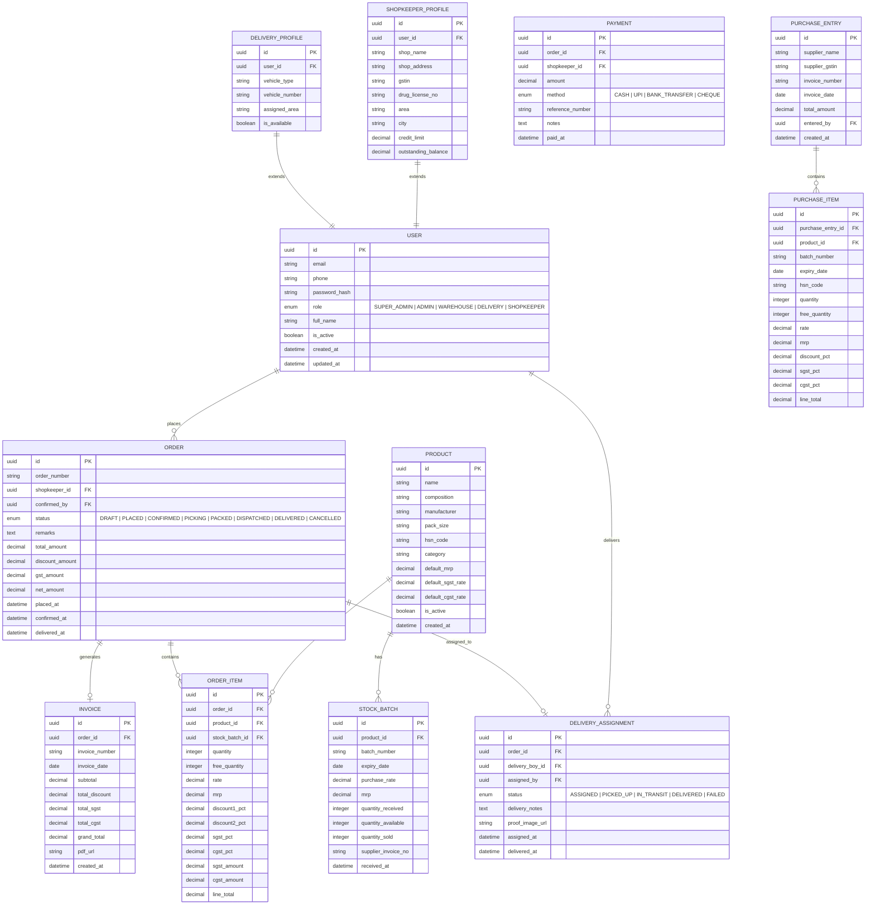

# 🗄️ Database Schema Design

## Entity-Relationship Diagram



## Tables Summary

| Table                | Purpose                                          | Key Relations           |
|----------------------|--------------------------------------------------|-------------------------|
| `users`              | All system users (unified, role-differentiated)  | —                       |
| `shopkeeper_profiles`| Extended info for shopkeeper users               | → users                 |
| `delivery_profiles`  | Extended info for delivery boy users             | → users                 |
| `products`           | Medicine master catalog                          | —                       |
| `stock_batches`      | Per-batch inventory tracking                     | → products              |
| `orders`             | Shopkeeper purchase orders                       | → users (shopkeeper)    |
| `order_items`        | Line items within an order                       | → orders, products      |
| `invoices`           | GST invoices generated from confirmed orders     | → orders                |
| `delivery_assignments` | Delivery boy assignment + tracking             | → orders, users         |
| `payments`           | Payment records against orders                   | → orders, users         |
| `purchase_entries`   | Incoming stock from distributors (header)        | → users (entered_by)    |
| `purchase_items`     | Line items in a purchase entry                   | → purchase_entries, products |

## Indexes

```sql
-- Performance-critical indexes
CREATE INDEX idx_orders_shopkeeper ON orders(shopkeeper_id, status);
CREATE INDEX idx_orders_status ON orders(status, placed_at DESC);
CREATE INDEX idx_stock_batches_product ON stock_batches(product_id, quantity_available);
CREATE INDEX idx_stock_batches_expiry ON stock_batches(expiry_date);
CREATE INDEX idx_order_items_order ON order_items(order_id);
CREATE INDEX idx_delivery_assignments_boy ON delivery_assignments(delivery_boy_id, status);
CREATE INDEX idx_payments_shopkeeper ON payments(shopkeeper_id, paid_at DESC);
CREATE INDEX idx_products_name ON products USING gin(to_tsvector('english', name));
```
